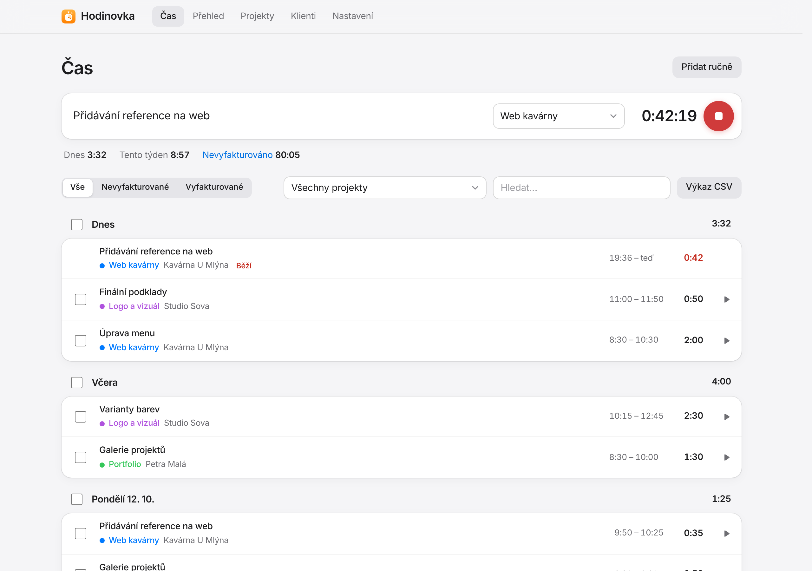
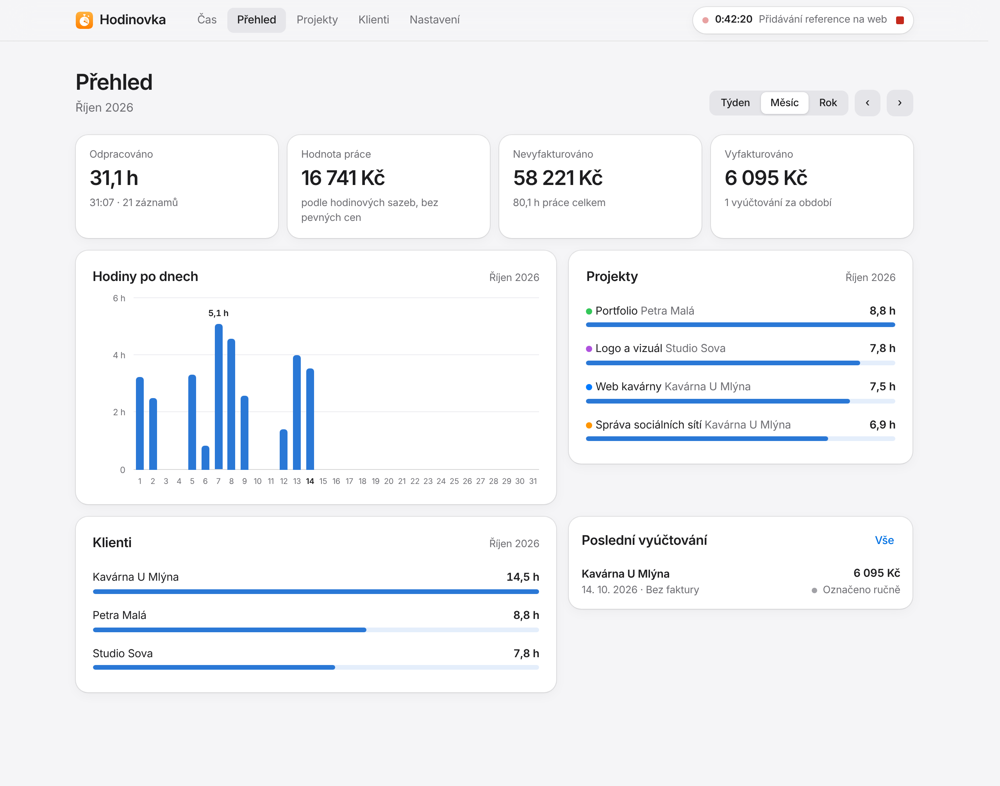

<p align="center">
  
</p>

<h1 align="center">Hodinovka</h1>

<p align="center">
  Jednoduché měření odpracovaného času pro Mac.<br>
  Zapneš, pracuješ, vypneš. Čas se zapíše k projektu a klientovi a jedním kliknutím z něj uděláš fakturu ve <a href="https://github.com/davidmalasek/faktury">Fakturách</a>.
</p>

<picture>
  <source media="(prefers-color-scheme: dark)" srcset="docs/cas-dark.png">
  
</picture>
<p align="center"><sub>Čas s ukázkovými daty</sub></p>

## Co umí

- **Časovač na jedno kliknutí.** Napíšeš, na čem pracuješ (třeba „Přidávání reference na web“), vybereš projekt a spustíš. Druhým kliknutím ho zastavíš. Běží, i když okno zavřeš nebo Mac uspíš, a odpracovaný čas ubíhá po sekundách i v horní liště Macu.
- **Projekty a klienti.** Každý záznam patří k projektu a projekt ke klientovi. Klientovi stačí jméno, IČO a adresu doplníš, až bude potřeba (nebo je načteš z ARES).
- **Hodinová sazba, nebo pevná cena.** U projektu nastavíš sazbu v Kč za hodinu, nebo pevnou cenu bez ohledu na počet hodin. U pevné ceny pak vidíš, kolik ti vychází na hodinu.
- **Co je vyfakturované a co ne.** Záznamy vybereš (po jednom, po dnech nebo celý projekt) a vyfakturuješ. Vybrané záznamy jde i najednou smazat.
- **Faktura sama.** Ve Fakturách se rovnou vytvoří faktura pro klienta i s položkami, hodinami, cenami a obdobím. Položka řekne, na čem se dělalo (třeba „Web kavárny – Úprava menu, Reference“). Odběratele i položky můžeš před vystavením změnit, třeba když chce klient fakturu na jinou firmu.
- **Stav faktury.** Hodinovka ukazuje, jestli je faktura zaplacená, po splatnosti nebo stornovaná.
- **Přehled bez přehlcení:** odpracované hodiny za týden, měsíc nebo rok, hodnota práce, co čeká na vyfakturování a na čem a pro koho jsi pracoval.
- **Výkaz práce v CSV** pro klienta nebo Excel, za projekt, období i konkrétní fakturu.
- **Ruční záznamy** pro chvíle, kdy jsi zapomněl časovač zapnout, a úprava kteréhokoli záznamu kliknutím.
- **Zálohy:** každý den automaticky, po každé změně kopie do iCloud Drive.
- **Sama se aktualizuje** z GitHubu.

<picture>
  <source media="(prefers-color-scheme: dark)" srcset="docs/prehled-dark.png">
  
</picture>

## Propojení s Fakturami

Hodinovka a [Faktury](https://github.com/davidmalasek/faktury) patří do jednoho systému aplikací **MejvOS**. Když jsou na Macu obě, najdou se samy a nic se nenastavuje:

- **Klienti se sdílí.** Kontakt z Faktur se ti nabídne při zakládání projektu v Hodinovce a klient z Hodinovky se nabídne u nové faktury. Jakmile ho jednou použiješ, zůstanou propojené a změny údajů (třeba doplněné IČO) se přenesou do druhé aplikace.
- **Vyfakturovat** vytvoří fakturu ve Fakturách. Číslo, splatnost a tvoje údaje doplní Faktury, PDF s QR platbou se vytvoří při jejím otevření. Tlačítko „Otevřít ve Fakturách“ tě na ni přenese.
- **Oběma směry.** Když v Hodinovce vrátíš vyúčtování mezi nevyfakturované, faktura se ve Fakturách smaže. A když fakturu smažeš ve Fakturách (i víc najednou), záznamy se v Hodinovce samy vrátí mezi nevyfakturované. Zaplacená faktura se sama nesmaže (je to příjem) a stornovaná zůstane ve Fakturách kvůli číselné řadě.
- **Všechno hned.** Otevřené okno se samo obnoví, když se něco změní v druhé aplikaci: faktura se ve Fakturách ukáže do pár vteřin a zaplacení uvidíš v Hodinovce, aniž bys cokoli načítal znovu.
- **Když Faktury na Macu nejsou,** Hodinovka je nabídne nainstalovat jedním kliknutím. Stáhnou se z GitHubu do Aplikací a hned se propojí.
- Faktury neběží? Hodinovka si je na pozadí spustí sama.

Je jedno, kterou aplikaci si stáhneš dřív. Obě v sobě nesou to, co k propojení potřebují. Jak to funguje uvnitř, popisuje [docs/mejvos.md](docs/mejvos.md).

## Požadavky

- **Mac s macOS 12 nebo novějším** (Apple Silicon i Intel).
- **Internet** pro aktualizace, načítání firem z ARES a instalaci Faktur. Když na Macu není Python, Hodinovka si při prvním spuštění stáhne vlastní (asi 25 MB).

Nic dalšího instalovat nemusíš.

## Instalace

1. Stáhni **[Hodinovka.zip](https://github.com/davidmalasek/hodinovka/releases/latest/download/Hodinovka.zip)**. Safari ZIP samo rozbalí, jinak na něj dvakrát klikni.
2. Přetáhni **Hodinovku** do složky **Aplikace**.
3. Otevři Hodinovku. Napoprvé ji macOS nepustí a napíše, že aplikaci nemůže ověřit. Je to proto, že appka není placeně podepsaná u Applu.
   Klikni na **Hotovo**, otevři **Nastavení systému → Soukromí a zabezpečení**, sjeď dolů a u hlášky o Hodinovce klikni na **Přesto otevřít** a potvrď. Tohle je potřeba jen jednou.

Když na Macu není Python, Hodinovka si ho při prvním otevření stáhne, takže chvíli trvá, než naběhne. Pak se macOS zeptá, jestli smí přistupovat k iCloud Drive kvůli záloze. Klikni na **Povolit**.

Hodinovka se otevře ve vlastním okně. Najdeš ji přes Spotlight (⌘ mezerník → „Hodinovka“) nebo v Launchpadu a můžeš si ji nechat v Docku.
Zavřením okna se Hodinovka neukončí: časovač dál ukazuje horní lišta Macu, kde ho jde i zastavit nebo spustit. Okno vrátí klik na ikonu v Docku, ukončí ji ⌘Q. Časovač spustíš nebo zastavíš i zkratkou ⇧⌘T.

Server Hodinovky běží na pozadí i po ukončení, takže se nic neztratí a další otevření je hned. Dokud běží, appka funguje i v prohlížeči na adrese http://localhost:8766.

## Aktualizace

Hodinovka se při každém otevření podívá na GitHub, jestli nevyšla nová verze. Když ano, sama ji stáhne a nainstaluje. Trvá to pár vteřin a pak se stránka sama načte znovu. Běžící časovač to nepřeruší.
Před aktualizací se data zazálohují a data aktualizace nikdy nepřepíše. Kterou verzi máš, uvidíš v **Nastavení** dole.

Výjimečně se změní i okno aplikace. Pak se stáhne nová Hodinovka.app a appku je potřeba ukončit a otevřít znovu.

## Fakturace

- **Hodinová sazba:** na faktuře je odpracovaný čas krát sazba. Hodiny se dají zaokrouhlovat nahoru na 6 minut, čtvrthodiny, půlhodiny nebo celé hodiny (Nastavení). Zaokrouhluje se součet každé položky.
- **Pevná cena:** vyfakturuje se jednou, bez ohledu na čas. Další záznamy na stejném projektu se pak nabídnou za 0 Kč (třeba když fakturuješ další část, cenu přepíšeš).
- **Položky:** jedna za projekt, nebo jedna za každý popis práce. Obojí jde přepnout přímo u fakturace a položky ručně upravit, přidat nebo smazat.
- **Odběratel:** výchozí je klient projektu. Můžeš vybrat jiný kontakt z Hodinovky nebo z Faktur, nebo zadat nového (s načtením z ARES). Faktura se pak vystaví na něj a ve Fakturách se uloží do kontaktů.
- **Vyúčtování bez faktury** ze starších verzí (kdy šlo záznamy jen označit) najdeš v Přehledu → Vyúčtování. Fakturu k nim vytvoříš tlačítkem Vytvořit fakturu.

Stejné záznamy nejde vyfakturovat dvakrát, a když se během vystavování ztratí spojení, opakované kliknutí fakturu nezdvojí.

## Soukromí

Appka nemá žádný vlastní server ani účet a nic nikam neposílá. Data leží jen ve složce `data` u tebe na disku a v kopii na tvém iCloud Drive.
Ven jde jen dotaz do veřejného registru ARES, když načítáš firmu podle IČO, a dotaz na GitHub, jestli nevyšla nová verze.
Appka poslouchá jen na `127.0.0.1`, takže se k ní nedostane nikdo jiný ze sítě. S Fakturami si data předává jen tady na Macu.

## Kde jsou data

Data jsou ve složce `~/Library/Application Support/Hodinovka/data` (ve vývojové instalaci ve složce `data` projektu). Přesnou cestu najdeš v Nastavení.

| Cesta | Co obsahuje |
|---|---|
| `data/hodinovka.json` | záznamy času, projekty, klienti, vyúčtování, nastavení (čitelný text) |
| `data/zalohy/` | automatická záloha před první změnou každého dne (30 dní) a před každou aktualizací |
| iCloud Drive → `Hodinovka záloha` | kopie všeho výše, aktualizuje se po každé změně |
| `~/Library/Application Support/MejvOS` | co si Hodinovka a Faktury navzájem ukazují (klienti, stav faktur) |

Složka `data` se do gitu záměrně neukládá, protože obsahuje osobní údaje klientů.

**Obnovení:** ukonči Hodinovku, vypni server (v Terminálu `kill $(cat ~/Library/Application\ Support/Hodinovka/data/server.pid)`) a na místo `data/hodinovka.json` zkopíruj vybraný soubor ze `data/zalohy` nebo z iCloud Drive.

## Pro vývoj

Vývojová instalace běží přímo ze složky projektu a data má v její podsložce `data`.
Potřebuje Python 3.9+ a vývojářské nástroje od Applu (`xcode-select --install`), ze kterých se sestaví okno aplikace:

```sh
git clone https://github.com/davidmalasek/hodinovka && cd hodinovka
./instalovat.sh                           # sestaví Hodinovka.app do Aplikací (spouští Hodinovku z této složky)
python3 server.py --open                  # ruční spuštění v prohlížeči
python3 -m unittest discover tests        # testy
```

Bez závislostí: backend na standardní knihovně Pythonu a frontend v čistém JavaScriptu. Vzhled i technika jsou stejné jako u Faktur, popisuje je [docs/styl.md](docs/styl.md).
Testovací data: `HODINOVKA_DATA=/jina/slozka HODINOVKA_PORT=8799 python3 server.py`. Do iCloudu se zálohují, jen když nastavíš `HODINOVKA_ICLOUD`, a do systému MejvOS se přihlásí, jen když nastavíš `MEJVOS_DIR`.

Okno aplikace je v `macos/Hodinovka.swift` (AppKit a WebKit) a sestavuje ho `macos/sestavit.sh`, stejně jako u Faktur ve dvou podobách: vývojová (`instalovat.sh`) a ke stažení (`Hodinovka.zip` z GitHub Actions).
Propojení s ostatními aplikacemi je v `mejvos.py`. Ten soubor je stejný ve všech aplikacích systému, takže když ho měníš, změň ho i ve Fakturách.

**Vydání nové verze:** zvyš číslo v souboru `VERSION` a pushni do `main`.
Když projdou testy a zkouška aplikace na macOS, GitHub Actions vytvoří vydání s `Hodinovka.zip` a ostatním se nová verze nainstaluje při dalším otevření.
Ve vývojové kopii z gitu se aktualizace neinstalují, aby nepřepsaly rozdělanou práci.

## Licence

[MIT](LICENSE).
